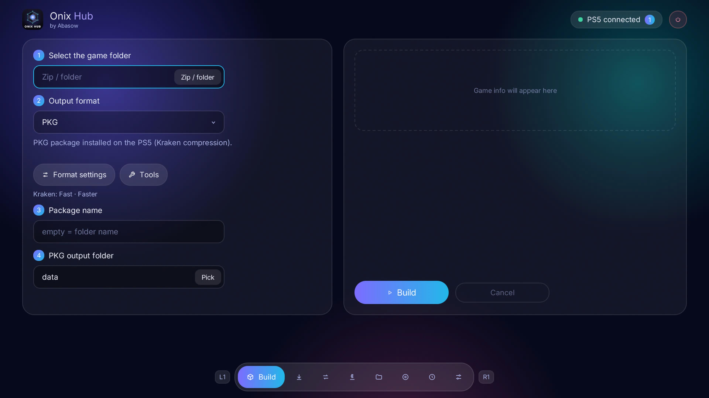
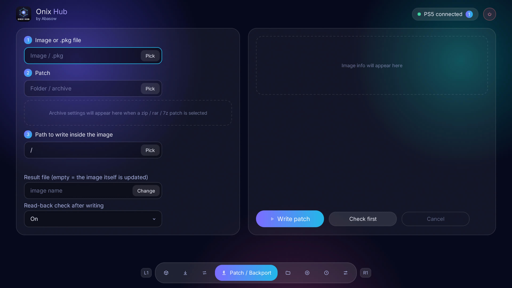
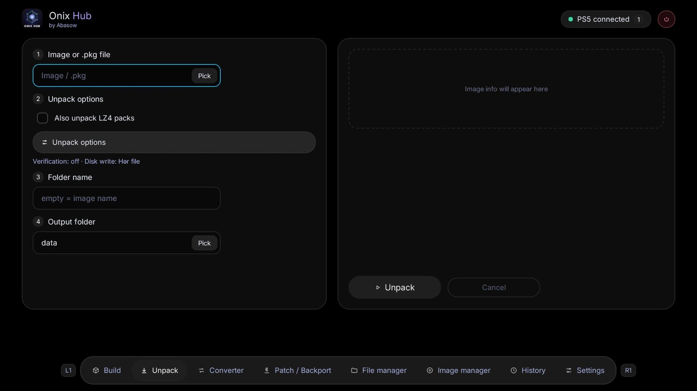
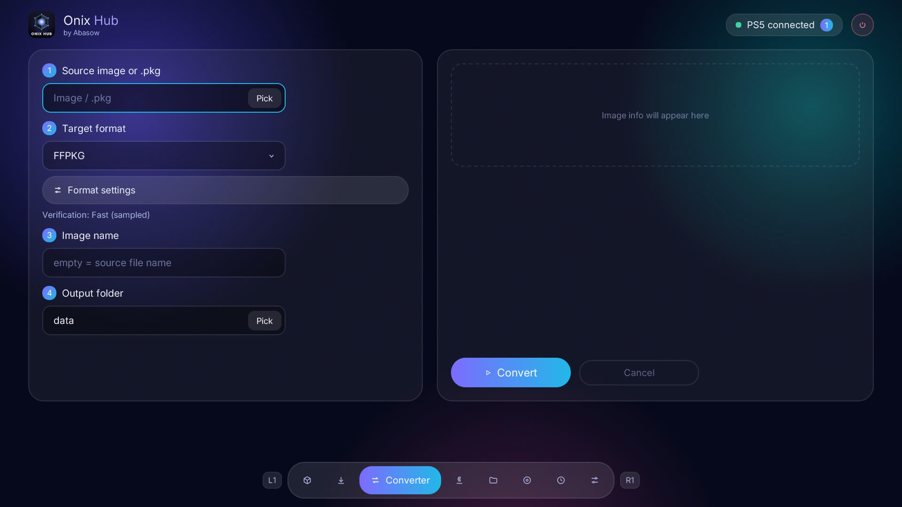
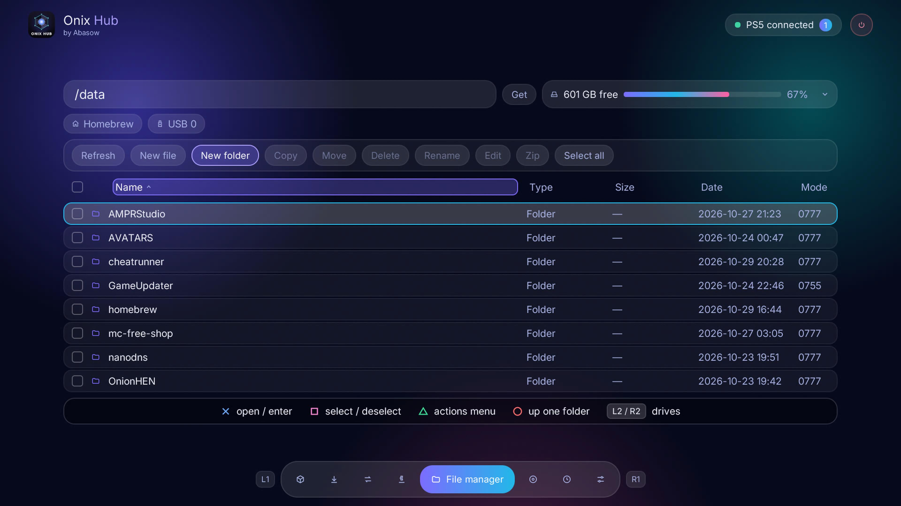
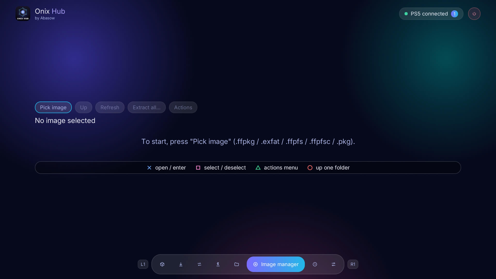

# ONIX HUB

**An image and PKG tool for the PS5**

🇬🇧 [English](#-english) · 🇦🇿 [Azərbaycanca](#-azərbaycanca) · 🇹🇷 [Türkçe](#-türkçe) · 🇷🇺 [Русский](#-русский)

 

---

## 🇬🇧 English

Runs on the console as a payload. Use it **two ways**: directly on the PS5 with the controller (the Onix Hub app), or from a phone / PC browser through the web GUI. Both have the same functions.

### ✨ Features

| | Feature | What it does |
|---|---|---|
| 🔨 | **Build** | Create PKG / FFPKG / exFAT images from a game folder or zip |
| 📦 | **Unpack** | Extract an image into a folder |
| 🔁 | **Converter** | Convert an image to another format (`.ffpkg`, `.exfat`, `.ffpfs`, `.ffpfsc`, `.pkg`), image to image directly |
| 🩹 | **Patch / Backport** | Patch `.pkg`, `.ffpfsc`, `.ffpkg`, `.ffpfs` and `.exfat` images in place. Pick a folder or a `.zip` / `.rar` / `.7z`; for an archive you browse inside it and choose the patch folder |
| 🗂️ | **File manager** | Browse the console's files (internal drive and USB). Create folders, rename, delete, copy, move, zip, edit text files |
| 💿 | **Image manager** | Look inside images without unpacking them. Create folders, rename, delete, add files or folders, or extract them from the image |
| 🎮 | **Game info card** | Selecting a game or image shows its cover, title, Region ID (PPSA code), version, SDK, file count, size and languages |
| 📥 | **Install queue** | Manage installs through a queue |
| 🕘 | **History** | List of finished Build / Unpack / Convert / Patch jobs with their result |
| 🎨 | **Themes** | Dark and light mode with a customizable accent and background color |
| 🔄 | **Auto-update** | Notifies you when a new release is available |
| 🌍 | **4 languages** | Azerbaijani, Turkish, Russian, English |
| 🔐 | **Pairing code** | Browser access is protected by a code shown on the PS5 screen |

> A `.pkg` is read-only in the manager: browse and extract only.

### 📸 Screenshots

| | |
|---|---|
|  **Build** |  **Unpack** |
|  **Converter** |  **Patch / Backport** |
|  **File manager** |  **Image manager** |

### ⬇ Download

Get the latest **`onix-hub.elf`** from the [Releases](https://github.com/abasow/onix-hub/releases/latest) page.

### 🚀 Usage

1. **Send** `onix-hub.elf` to your PS5 with your payload sender (port `9021`).
2. Then use it either way:
   - **On the PS5:** the Onix Hub app opens on the console. Control it with the controller.
   - **In a browser:** open the address shown on the PS5 screen, `http://<PS5-IP>:<port>`, on your phone or PC and enter the 6-digit pairing code shown on the PS5.

### 🎮 Controller (on the PS5)

| Button | Action |
|---|---|
| **L1 / R1** | Previous / next section |
| **✕** | Open / enter / confirm |
| **○** | Back / up one folder |
| **□** | Select / deselect (file lists) |
| **△** | Actions menu |
| **L2 / R2** | Switch drive (file manager) |
| **Options** | Settings |

### 📋 Requirements

- A jailbroken PS5 with an ELF loader running

### ⚠️ Disclaimer

Provided as is, without warranty. Use at your own risk.

---

## 🇦🇿 Azərbaycanca

PS5-də payload kimi işləyir. **İki cür** istifadə edə bilərsən: birbaşa PS5-də pultla (Onix Hub tətbiqi) və ya telefon / kompüter brauzerindən veb interfeys vasitəsilə. İkisində də funksiyalar eynidir.

### ✨ Özəlliklər

| | Özəllik | Nə edir |
|---|---|---|
| 🔨 | **Build** | Oyun qovluğundan və ya zipdən PKG / FFPKG / exFAT imicləri yaradır |
| 📦 | **Unpack** | İmici qovluğa çıxarır |
| 🔁 | **Çevirici** | İmici başqa formata çevirir (`.ffpkg`, `.exfat`, `.ffpfs`, `.ffpfsc`, `.pkg`), imicdən imica birbaşa |
| 🩹 | **Yama / Backport** | `.pkg`, `.ffpfsc`, `.ffpkg`, `.ffpfs` və `.exfat` imiclərini yerindəcə yamaqlayır. Qovluq və ya `.zip` / `.rar` / `.7z` seçilir; arxivin içinə girib yama qovluğunu seçirsən |
| 🗂️ | **Fayl meneceri** | Konsolun fayllarına (daxili disk və USB) baxırsan. Qovluq yarat, adını dəyiş, sil, kopyala, köçür, zip et, mətn fayllarını redaktə et |
| 💿 | **İmic meneceri** | İmiclərin içinə açmadan baxırsan. Qovluq yarat, adını dəyiş, sil, fayl və ya qovluq əlavə et, ya da imicdən çıxar |
| 🎮 | **Oyun məlumat kartı** | Oyun və ya imic seçəndə örtük, ad, Region ID (PPSA kodu), versiya, SDK, fayl sayı, ölçü və dillər göstərilir |
| 📥 | **Quraşdırma növbəsi** | Quraşdırmaları növbə ilə idarə edir |
| 🕘 | **Tarixçə** | Bitmiş Build / Unpack / Convert / Patch işlərinin nəticəsi ilə siyahısı |
| 🎨 | **Temalar** | Tünd və açıq rejim, dəyişdirilə bilən vurğu və fon rəngi |
| 🔄 | **Avtomatik yeniləmə** | Yeni buraxılış çıxanda xəbər verir |
| 🌍 | **4 dil** | Azərbaycan, Türk, Rus, İngilis |
| 🔐 | **Qoşulma kodu** | Brauzer girişi PS5 ekranında göstərilən kodla qorunur |

> Menecerdə `.pkg` yalnız oxunur: baxmaq və çıxarmaq olar.

### 📸 Ekran görüntüləri

| | |
|---|---|
|  **Build** |  **Unpack** |
|  **Çevirici** |  **Yama / Backport** |
|  **Fayl meneceri** |  **İmic meneceri** |

### ⬇ Yüklə

Ən son **`onix-hub.elf`** faylını [Releases](https://github.com/abasow/onix-hub/releases/latest) səhifəsindən götür.

### 🚀 İstifadə

1. `onix-hub.elf` faylını payload göndəricin ilə PS5-ə **göndər** (port `9021`).
2. Sonra istədiyin yolla istifadə et:
   - **PS5-də:** Onix Hub tətbiqi konsolda açılır. Pultla idarə et.
   - **Brauzerdə:** PS5 ekranında görünən ünvanı, `http://<PS5-IP>:<port>`, telefon və ya kompüter brauzerində aç və PS5-də göstərilən 6 rəqəmli qoşulma kodunu daxil et.

### 🎮 Pult (PS5-də)

| Düymə | Əməliyyat |
|---|---|
| **L1 / R1** | Əvvəlki / sonrakı bölmə |
| **✕** | Aç / daxil ol / təsdiq et |
| **○** | Geri / bir qovluq yuxarı |
| **□** | Seç / seçimi götür (fayl siyahıları) |
| **△** | Əməliyyat menyusu |
| **L2 / R2** | Disk dəyiş (fayl meneceri) |
| **Options** | Ayarlar |

### 📋 Tələblər

- Jailbreak edilmiş və ELF loader işləyən PS5

### ⚠️ Məsuliyyətdən imtina

Olduğu kimi, heç bir zəmanət olmadan təqdim olunur. Risk sənə aiddir.

---

## 🇹🇷 Türkçe

PS5'te payload olarak çalışır. **İki şekilde** kullanabilirsiniz: doğrudan PS5'te kumandayla (Onix Hub uygulaması) veya telefon / bilgisayar tarayıcısından web arayüzüyle. İkisinde de işlevler aynıdır.

### ✨ Özellikler

| | Özellik | Ne yapar |
|---|---|---|
| 🔨 | **Build** | Oyun klasöründen veya zipten PKG / FFPKG / exFAT imajları oluşturur |
| 📦 | **Unpack** | İmajı bir klasöre çıkarır |
| 🔁 | **Dönüştürücü** | İmajı başka biçime dönüştürür (`.ffpkg`, `.exfat`, `.ffpfs`, `.ffpfsc`, `.pkg`), imajdan imaja doğrudan |
| 🩹 | **Yama / Backport** | `.pkg`, `.ffpfsc`, `.ffpkg`, `.ffpfs` ve `.exfat` imajlarını yerinde yamalar. Klasör veya `.zip` / `.rar` / `.7z` seçilir; arşivin içine girip yama klasörünü seçersiniz |
| 🗂️ | **Dosya yöneticisi** | Konsolun dosyalarına (dahili disk ve USB) göz atarsınız. Klasör oluşturun, yeniden adlandırın, silin, kopyalayın, taşıyın, zipleyin, metin dosyalarını düzenleyin |
| 💿 | **İmaj yöneticisi** | İmajların içine açmadan göz atarsınız. Klasör oluşturun, yeniden adlandırın, silin, dosya veya klasör ekleyin ya da imajdan çıkarın |
| 🎮 | **Oyun bilgi kartı** | Oyun veya imaj seçildiğinde kapak, ad, Region ID (PPSA kodu), sürüm, SDK, dosya sayısı, boyut ve diller gösterilir |
| 📥 | **Kurulum kuyruğu** | Kurulumları bir kuyruk üzerinden yönetir |
| 🕘 | **Geçmiş** | Biten Build / Unpack / Convert / Patch işlerinin sonuçlarıyla listesi |
| 🎨 | **Temalar** | Koyu ve açık mod, ayarlanabilir vurgu ve arka plan rengi |
| 🔄 | **Otomatik güncelleme** | Yeni sürüm çıktığında bildirir |
| 🌍 | **4 dil** | Azerbaycanca, Türkçe, Rusça, İngilizce |
| 🔐 | **Eşleştirme kodu** | Tarayıcı erişimi PS5 ekranında gösterilen kodla korunur |

> Yöneticide `.pkg` salt okunurdur: yalnızca göz atma ve çıkarma yapılabilir.

### 📸 Ekran görüntüleri

| | |
|---|---|
|  **Build** |  **Unpack** |
|  **Dönüştürücü** |  **Yama / Backport** |
|  **Dosya yöneticisi** |  **İmaj yöneticisi** |

### ⬇ İndir

En son **`onix-hub.elf`** dosyasını [Releases](https://github.com/abasow/onix-hub/releases/latest) sayfasından alın.

### 🚀 Kullanım

1. `onix-hub.elf` dosyasını payload göndericinizle PS5'e **gönderin** (port `9021`).
2. Sonra istediğiniz yolla kullanın:
   - **PS5'te:** Onix Hub uygulaması konsolda açılır. Kumandayla yönetin.
   - **Tarayıcıda:** PS5 ekranında görünen adresi, `http://<PS5-IP>:<port>`, telefon veya bilgisayarınızın tarayıcısında açın ve PS5'te gösterilen 6 haneli eşleştirme kodunu girin.

### 🎮 Kumanda (PS5'te)

| Düğme | İşlem |
|---|---|
| **L1 / R1** | Önceki / sonraki bölüm |
| **✕** | Aç / gir / onayla |
| **○** | Geri / bir klasör yukarı |
| **□** | Seç / seçimi kaldır (dosya listeleri) |
| **△** | İşlem menüsü |
| **L2 / R2** | Sürücü değiştir (dosya yöneticisi) |
| **Options** | Ayarlar |

### 📋 Gereksinimler

- Jailbreak yapılmış ve ELF loader çalışan bir PS5

### ⚠️ Sorumluluk reddi

Olduğu gibi, herhangi bir garanti olmadan sunulur. Risk size aittir.

---

## 🇷🇺 Русский

Работает на консоли как payload. Пользоваться можно **двумя способами**: прямо на PS5 с геймпада (приложение Onix Hub) или через веб-интерфейс в браузере телефона или ПК. Функции в обоих одинаковые.

### ✨ Возможности

| | Функция | Что делает |
|---|---|---|
| 🔨 | **Build** | Создаёт образы PKG / FFPKG / exFAT из папки игры или zip |
| 📦 | **Unpack** | Извлекает образ в папку |
| 🔁 | **Конвертер** | Конвертирует образ в другой формат (`.ffpkg`, `.exfat`, `.ffpfs`, `.ffpfsc`, `.pkg`), образ в образ напрямую |
| 🩹 | **Патч / Backport** | Патчит образы `.pkg`, `.ffpfsc`, `.ffpkg`, `.ffpfs` и `.exfat` на месте. Выбирается папка или `.zip` / `.rar` / `.7z`; в архиве вы заходите внутрь и выбираете папку патча |
| 🗂️ | **Файловый менеджер** | Просмотр файлов консоли (внутренний диск и USB). Создание папок, переименование, удаление, копирование, перемещение, упаковка в zip, правка текстовых файлов |
| 💿 | **Менеджер образов** | Просмотр содержимого образов без распаковки. Создание папок, переименование, удаление, добавление файлов или папок, извлечение из образа |
| 🎮 | **Карточка игры** | При выборе игры или образа показываются обложка, название, Region ID (код PPSA), версия, SDK, число файлов, размер и языки |
| 📥 | **Очередь установки** | Управление установками через очередь |
| 🕘 | **История** | Список завершённых задач Build / Unpack / Convert / Patch с результатом |
| 🎨 | **Темы** | Тёмный и светлый режим, настраиваемый акцентный и фоновый цвет |
| 🔄 | **Автообновление** | Уведомляет о выходе новой версии |
| 🌍 | **4 языка** | Азербайджанский, турецкий, русский, английский |
| 🔐 | **Код сопряжения** | Доступ из браузера защищён кодом, который показывается на экране PS5 |

> `.pkg` в менеджере доступен только для чтения: можно просматривать и извлекать.

### 📸 Скриншоты

| | |
|---|---|
|  **Build** |  **Unpack** |
|  **Конвертер** |  **Патч / Backport** |
|  **Файловый менеджер** |  **Менеджер образов** |

### ⬇ Скачать

Последний **`onix-hub.elf`** берите на странице [Releases](https://github.com/abasow/onix-hub/releases/latest).

### 🚀 Использование

1. **Отправьте** `onix-hub.elf` на PS5 вашим отправщиком payload'ов (порт `9021`).
2. Затем пользуйтесь любым способом:
   - **На PS5:** приложение Onix Hub открывается на консоли. Управляйте геймпадом.
   - **В браузере:** откройте адрес, показанный на экране PS5, `http://<PS5-IP>:<port>`, в браузере телефона или ПК и введите 6-значный код сопряжения, показанный на PS5.

### 🎮 Геймпад (на PS5)

| Кнопка | Действие |
|---|---|
| **L1 / R1** | Предыдущий / следующий раздел |
| **✕** | Открыть / войти / подтвердить |
| **○** | Назад / на папку вверх |
| **□** | Выбрать / снять выбор (списки файлов) |
| **△** | Меню действий |
| **L2 / R2** | Сменить диск (файловый менеджер) |
| **Options** | Настройки |

### 📋 Требования

- PS5 с джейлбрейком и запущенным ELF-загрузчиком

### ⚠️ Отказ от ответственности

Предоставляется «как есть», без каких-либо гарантий. Используйте на свой риск.

---

by <b>Abasow</b>

