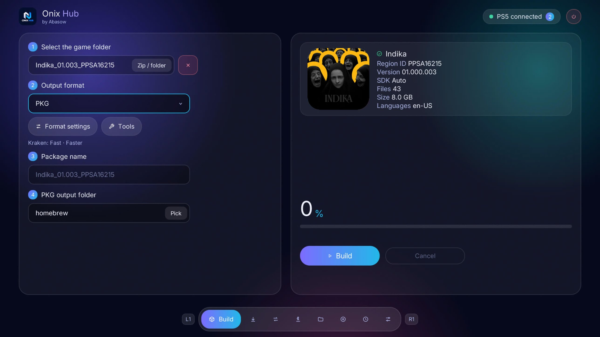
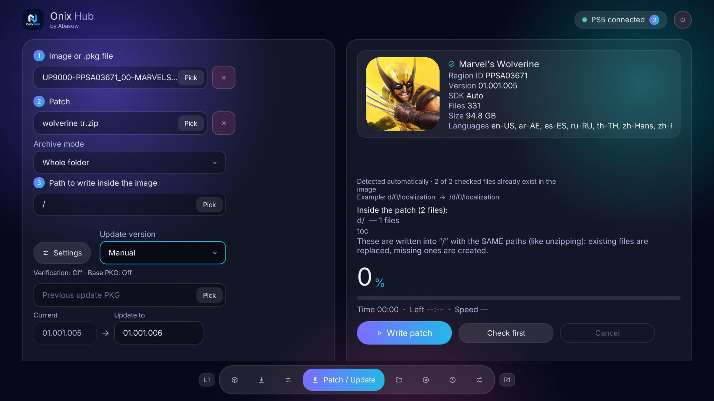
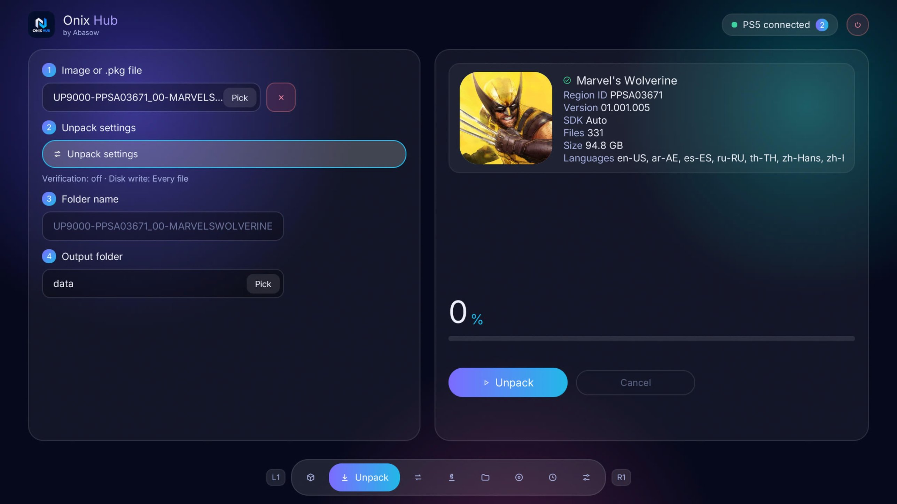
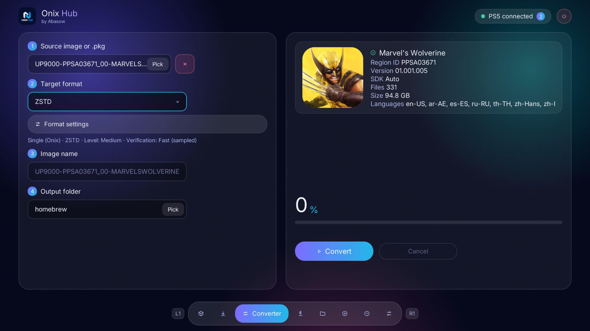
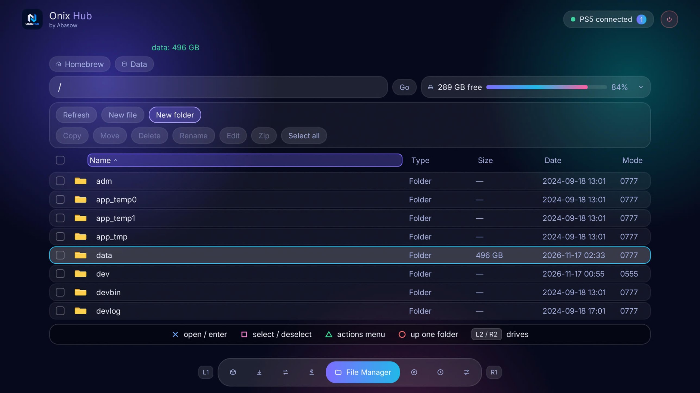
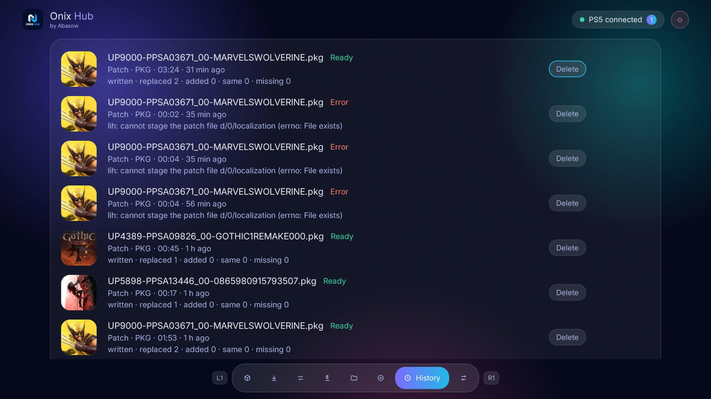
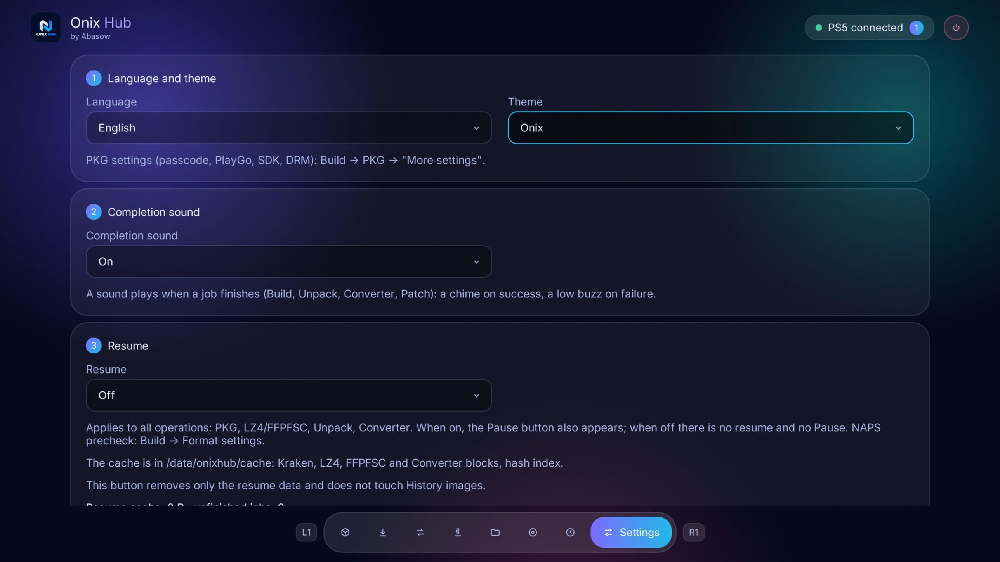

# ONIX HUB

**An image and PKG tool for the PS5**

🇬🇧 [English](#-english) · 🇦🇿 [Azərbaycanca](#-azərbaycanca) · 🇹🇷 [Türkçe](#-türkçe) · 🇷🇺 [Русский](#-русский)

 

---

## 🇬🇧 English

Runs on the console as a payload. Use it **two ways**: directly on the PS5 with the controller (the Onix Hub app), or from a phone / PC browser through the web GUI. Both have the same functions.

### ✨ Features

| | Feature | What it does |
|---|---|---|
| 🔨 | **Build** | Build a game folder or zip into **PKG** (Kraken compression), **FFPKG** (UFS2), **EXFAT**, **FFPFS** or **FFPFSC** (compressed PFS container, inner format and level 0–9), or into **LZ4 / ZSTD** packs. Choose the PlayGo languages (Auto or ticked ones) |
| 🗜️ | **LZ4 / ZSTD packs** | New. Pack a game folder into **LZ4** or **ZSTD** packs: some game files go into `.pak` volumes, the result is an ordinary folder (or you can write straight into an image) that you can convert to any format. ZSTD is its own format, usually smaller than LZ4. Choose the compression preset and the volume layout. Optional **trace**: run the game once with the tracing runtime, give the journal, and only the files the game actually read are packed. A cancelled job can keep its partial result |
| 📦 | **Unpack** | Extract an image or a `.pkg` into a folder; the format is recognised from the file's content. An LZ4 / ZSTD-packed image is unpacked automatically into the plain game folder, with the game's own runtime put back |
| 🔁 | **Converter** | Convert an image to another format (`.ffpkg`, `.exfat`, `.ffpfs`, `.ffpfsc`, `.pkg`, LZ4, ZSTD), image to image directly |
| 🩹 | **Patch / Update** | Write a patch (for example a translation) into the files inside `.ffpkg`, `.ffpfs`, `.ffpfsc` and `.exfat` images, or into a `.pkg`. Pick a folder or a `.zip` / `.rar` / `.7z`; for an archive you browse inside it and choose the patch folder. Files are matched to the image by name; files that are not in the image are added as new. LZ4 / ZSTD-packed images can be patched and packed again. The original `.pkg` is never modified. **Check first** tests the patch without writing anything |
| 🆕 | **Update PKG** | New. In **Patch / Update**, create an **update PKG** from a base game PKG and a patch folder or archive. The update contains only the changed blocks. The update version is automatic, or you set it by hand (Manual) and may pick a **previous update PKG** to continue from: the new version must be higher than the previous one |
| 🗂️ | **File manager** | Browse the console's files (internal drive, USB and NTFS USB). Shows size, date and mode, and the free space of the drive. Create files and folders, rename, delete, copy, cut, paste, move, zip, edit text files |
| 💿 | **Image manager** | Look inside images without unpacking them. Create folders, rename, delete, add files or folders, or extract them from the image |
| 🎮 | **Game info card** | Selecting a game or image shows its cover, title, Region ID (PPSA code), version, SDK, file count, size and languages |
| 📥 | **Install queue** | Manage installs through a queue |
| ⏯️ | **Resume and pause** | Turn on **Resume** in Settings: it applies to PKG, LZ4 / FFPFSC, Unpack and Converter jobs, and a **Pause** button appears. Unfinished jobs keep their resume data (in `/data/onixhub/cache`), so blocks that are already compressed are skipped on the next run |
| 💾 | **Remembers your steps** | Source, output folder, format and the last screen are kept, so after closing and reopening you continue where you left off |
| 🕘 | **History** | Finished Build / Unpack / Convert / Patch jobs with the game cover, duration, how long ago, and the result (for a patch: written, replaced, added, same, missing files) or the error. Each entry can be deleted |
| 🎨 | **Themes** | Dark and light mode with a customizable accent and background color |
| ⚙️ | **Settings** | Language, theme, a completion sound (a chime on success, a low buzz on failure) and Resume |
| 🔄 | **Auto-update** | Notifies you when a new release is available |
| 🌍 | **12 languages** | Azerbaijani, Turkish, Russian, English, Arabic, German, Spanish, French, Italian, Japanese, Portuguese, Chinese |
| 🔐 | **Pairing code** | Browser access is protected by a code shown on the PS5 screen |

> A `.pkg` is read-only in the manager: browse and extract only.

### 🆕 Creating an update PKG

1. Open **Patch / Update** and choose the base game `.pkg`.
2. Choose the patch folder, or a `.zip` / `.rar` / `.7z` and browse to the patch folder inside it.
3. Update version: leave it on **Automatic**, or choose **Manual** and type the version (full `NN.NNN.NNN`, or only the last three digits).
4. In Manual mode you can select the **previous update PKG** to continue an earlier update. The new version must be higher.
5. Write the patch. The result is an update PKG that holds only the changed blocks.

### 📸 Screenshots

| | |
|---|---|
|  **Build** |  **Unpack** |
|  **Converter** |  **Patch / Update** |
|  **File manager** |  **History** |
|  **Settings** | |

### ⬇ Download

Get the latest release from the [Releases](https://github.com/abasow/onix-hub/releases/latest) page:
- **`onix-hub.elf`**: the engine (payload).
- **`PPSA01959.zip`**: the **Onix Hub app** (title ID `PPSA01959`).

### 🚀 Usage

Onix Hub has two parts: the **engine** (`onix-hub.elf`) and the **app** (`PPSA01959`). You can use it in two ways.

**1. As an app on the PS5 (controller)**
1. Install the app: send `onix-hub.elf` to the console, open the web GUI and, when it asks **Install as an app?**, choose the app. `PPSA01959.zip` is unpacked into `/data/homebrew` and **Onix Hub** appears in Games.
2. Open the **Onix Hub** app. It starts the engine itself by sending its own `onix-hub.elf` to the ELF loader on the console (`127.0.0.1:9021`), so the loader must be running.
3. Control it with the controller.

**2. In a browser (phone / PC)**
1. **Send** `onix-hub.elf` to your PS5 with your payload sender (port `9021`).
2. Open the address shown on the PS5 screen, `http://<PS5-IP>:<port>`, and enter the 6-digit pairing code shown on the PS5.

### 🎮 Controller (in the app on the PS5)

| Button | Action |
|---|---|
| **L1 / R1** | Previous / next section |
| **✕** | Open / enter / confirm |
| **○** | Back / up one folder |
| **□** | Select / deselect (file lists) |
| **△** | Actions menu |
| **L2 / R2** | Switch drive (file manager) |
| **Options** | Settings |

### 📋 Requirements

- A jailbroken PS5 with an ELF loader running (port `9021`). The app needs it to start the engine

### ⚠️ Disclaimer

Provided as is, without warranty. Use at your own risk.

---

## 🇦🇿 Azərbaycanca

PS5-də payload kimi işləyir. **İki cür** istifadə edə bilərsən: birbaşa PS5-də pultla (Onix Hub tətbiqi) və ya telefon / kompüter brauzerindən veb interfeys vasitəsilə. İkisində də funksiyalar eynidir.

### ✨ Özəlliklər

| | Özəllik | Nə edir |
|---|---|---|
| 🔨 | **Build** | Oyun qovluğunu və ya zipi **PKG** (Kraken sıxması), **FFPKG** (UFS2), **EXFAT**, **FFPFS** və ya **FFPFSC** (sıxılmış PFS konteyneri, daxili format və səviyyə 0–9) formatına, ya da **LZ4 / ZSTD** paketlərinə build edir. PlayGo dillərini seçə bilərsən (Avto və ya işarələnənlər) |
| 🗜️ | **LZ4 / ZSTD paketlər** | Yeni. Oyun qovluğunu **LZ4** və ya **ZSTD** paketlərinə yığır: oyun fayllarının bir hissəsi `.pak` həcmlərinə düşür, nəticə adi qovluqdur (və ya birbaşa imicə yaza bilərsən) və istənilən formata çevirə bilərsən. ZSTD ayrıca formatdır, adətən LZ4-dən kiçik olur. Sıxma ön tənzimini və həcm düzülüşünü seçirsən. İstəyə görə **iz (trace)**: oyunu izləmə runtime ilə bir dəfə işlədirsən, jurnalı verirsən və yalnız oyunun oxuduğu fayllar paketlənir. Ləğv olunan iş yarımçıq nəticəni saxlaya bilər |
| 📦 | **Unpack** | İmici və ya `.pkg`-ni qovluğa çıxarır; format faylın məzmunundan tanınır. LZ4 / ZSTD paketlənmiş imic avtomatik açılır: nəticə adi oyun qovluğudur, oyunun öz runtime-ı geri qoyulur |
| 🔁 | **Çevirici** | İmici başqa formata çevirir (`.ffpkg`, `.exfat`, `.ffpfs`, `.ffpfsc`, `.pkg`, LZ4, ZSTD), imicdən imica birbaşa |
| 🩹 | **Yama / Update** | Yamanı (məsələn tərcümə yaması) `.ffpkg`, `.ffpfs`, `.ffpfsc` və `.exfat` imiclərinin içindəki fayllara və ya `.pkg`-yə yazır. Qovluq və ya `.zip` / `.rar` / `.7z` seçilir; arxivin içinə girib yama qovluğunu seçirsən. Fayllar imicdə ada görə tapılır; imicdə olmayan fayl yeni fayl kimi əlavə olunur. LZ4 / ZSTD paketlənmiş imiclər yamaqlanıb yenidən paketlənə bilər. Orijinal `.pkg` dəyişmir. **Check first** düyməsi heç nə yazmadan yamanı yoxlayır |
| 🆕 | **Update PKG** | Yeni. **Yama / Update** bölməsində baza oyun PKG-sindən və yama qovluğundan və ya arxivindən **update PKG** hazırlayır. Update yalnız dəyişən blokları saxlayır. Update versiyası avtomatikdir, ya da əllə (Manual) yazırsan və davam etmək üçün **əvvəlki update PKG** seçə bilərsən: yeni versiya əvvəlkindən yüksək olmalıdır |
| 🗂️ | **Fayl meneceri** | Konsolun fayllarına (daxili disk, USB və NTFS USB) baxırsan. Ölçü, tarix və icazə rejimi, həmçinin diskin boş yeri göstərilir. Fayl və qovluq yarat, adını dəyiş, sil, kopyala, kəs, yapışdır, köçür, zip et, mətn fayllarını redaktə et |
| 💿 | **İmic meneceri** | İmiclərin içinə açmadan baxırsan. Qovluq yarat, adını dəyiş, sil, fayl və ya qovluq əlavə et, ya da imicdən çıxar |
| 🎮 | **Oyun məlumat kartı** | Oyun və ya imic seçəndə örtük, ad, Region ID (PPSA kodu), versiya, SDK, fayl sayı, ölçü və dillər göstərilir |
| 📥 | **Quraşdırma növbəsi** | Quraşdırmaları növbə ilə idarə edir |
| ⏯️ | **Davam və pauza** | Ayarlarda **Resume**-u aç: PKG, LZ4 / FFPFSC, Unpack və Çevirici işlərinə aiddir və **Pause** düyməsi çıxır. Yarımçıq işlər davam məlumatını (`/data/onixhub/cache`) saxlayır, ona görə növbəti işə salmada artıq sıxılmış bloklar atlanır |
| 💾 | **Addımları yadda saxlayır** | Mənbə, çıxış qovluğu, format və son ekran saxlanır; proqramı bağlayıb açanda qaldığın yerdən davam edirsən |
| 🕘 | **Tarixçə** | Bitmiş Build / Unpack / Convert / Patch işləri: oyun örtüyü, müddət, nə vaxt olduğu və nəticə (yamada: yazılan, əvəz olunan, əlavə olunan, eyni və tapılmayan fayllar) ya da xəta. Hər qeydi silmək olar |
| 🎨 | **Temalar** | Tünd və açıq rejim, dəyişdirilə bilən vurğu və fon rəngi |
| ⚙️ | **Ayarlar** | Dil, tema, iş bitəndə səs (uğurda zəng, xətada alçaq səs) və Resume |
| 🔄 | **Avtomatik yeniləmə** | Yeni buraxılış çıxanda xəbər verir |
| 🌍 | **12 dil** | Azərbaycan, Türk, Rus, İngilis, Ərəb, Alman, İspan, Fransız, İtalyan, Yapon, Portuqal, Çin |
| 🔐 | **Qoşulma kodu** | Brauzer girişi PS5 ekranında göstərilən kodla qorunur |

> Menecerdə `.pkg` yalnız oxunur: baxmaq və çıxarmaq olar.

### 🆕 Update PKG necə hazırlanır

1. **Yama / Update** bölməsini aç və baza oyun `.pkg` faylını seç.
2. Yama qovluğunu, ya da `.zip` / `.rar` / `.7z` seç və arxivin içində yama qovluğuna get.
3. Update versiyası: **Avtomatik** qoy, ya da **Manual** seçib versiyanı yaz (tam `NN.NNN.NNN` və ya yalnız son üç rəqəm).
4. Manual rejimdə əvvəlki update-i davam etdirmək üçün **əvvəlki update PKG**-ni seçə bilərsən. Yeni versiya yüksək olmalıdır.
5. Yamanı yaz. Nəticə yalnız dəyişən blokları saxlayan update PKG-dir.

### 📸 Ekran görüntüləri

| | |
|---|---|
|  **Build** |  **Unpack** |
|  **Çevirici** |  **Yama / Update** |
|  **Fayl meneceri** |  **Tarixçə** |
|  **Ayarlar** | |

### ⬇ Yüklə

Ən son buraxılışı [Releases](https://github.com/abasow/onix-hub/releases/latest) səhifəsindən götür:
- **`onix-hub.elf`**: mühərrik (payload).
- **`PPSA01959.zip`**: **Onix Hub tətbiqi** (title ID `PPSA01959`).

### 🚀 İstifadə

Onix Hub iki hissədən ibarətdir: **mühərrik** (`onix-hub.elf`) və **tətbiq** (`PPSA01959`). İki cür istifadə edə bilərsən.

**1. PS5-də tətbiq kimi (pultla)**
1. Tətbiqi quraşdır: `onix-hub.elf` faylını konsola göndər, veb interfeysi aç və **Tətbiq kimi quraşdırılsın?** sualı çıxanda tətbiqi seç. `PPSA01959.zip` `/data/homebrew` qovluğuna açılır və **Onix Hub** Games bölməsində görünür.
2. **Onix Hub** tətbiqini aç. O, mühərriki özü işə salır: öz `onix-hub.elf` faylını konsoldakı ELF loader-ə (`127.0.0.1:9021`) göndərir, ona görə loader işləməlidir.
3. Pultla idarə et.

**2. Brauzerdə (telefon / kompüter)**
1. `onix-hub.elf` faylını payload göndəricin ilə PS5-ə **göndər** (port `9021`).
2. PS5 ekranında görünən ünvanı, `http://<PS5-IP>:<port>`, aç və PS5-də göstərilən 6 rəqəmli qoşulma kodunu daxil et.

### 🎮 Pult (PS5-də, tətbiqdə)

| Düymə | Əməliyyat |
|---|---|
| **L1 / R1** | Əvvəlki / sonrakı bölmə |
| **✕** | Aç / daxil ol / təsdiq et |
| **○** | Geri / bir qovluq yuxarı |
| **□** | Seç / seçimi götür (fayl siyahıları) |
| **△** | Əməliyyat menyusu |
| **L2 / R2** | Disk dəyiş (fayl meneceri) |
| **Options** | Ayarlar |

### 📋 Tələblər

- Jailbreak edilmiş və ELF loader işləyən PS5 (port `9021`). Tətbiq mühərriki başlatmaq üçün ona ehtiyac duyur

### ⚠️ Məsuliyyətdən imtina

Olduğu kimi, heç bir zəmanət olmadan təqdim olunur. Risk sənə aiddir.

---

## 🇹🇷 Türkçe

PS5'te payload olarak çalışır. **İki şekilde** kullanabilirsiniz: doğrudan PS5'te kumandayla (Onix Hub uygulaması) veya telefon / bilgisayar tarayıcısından web arayüzüyle. İkisinde de işlevler aynıdır.

### ✨ Özellikler

| | Özellik | Ne yapar |
|---|---|---|
| 🔨 | **Build** | Oyun klasörünü veya zip'i **PKG** (Kraken sıkıştırma), **FFPKG** (UFS2), **EXFAT**, **FFPFS** veya **FFPFSC** (sıkıştırılmış PFS konteyneri, iç biçim ve seviye 0–9) biçimine ya da **LZ4 / ZSTD** paketlerine build eder. PlayGo dilleri seçilebilir (Otomatik veya işaretlenenler) |
| 🗜️ | **LZ4 / ZSTD paketleri** | Yeni. Oyun klasörünü **LZ4** veya **ZSTD** paketlerine toplar: oyun dosyalarının bir kısmı `.pak` birimlerine girer, sonuç sıradan bir klasördür (ya da doğrudan imaja yazabilirsiniz) ve istediğiniz biçime dönüştürebilirsiniz. ZSTD ayrı bir biçimdir, genellikle LZ4'ten küçüktür. Sıkıştırma ön ayarını ve birim düzenini seçersiniz. İsteğe bağlı **iz (trace)**: oyunu izleme runtime'ı ile bir kez çalıştırır, günlüğü verirsiniz ve yalnızca oyunun okuduğu dosyalar paketlenir. İptal edilen iş yarım sonucu saklayabilir |
| 📦 | **Unpack** | İmajı veya `.pkg`'yi klasöre çıkarır; biçim dosyanın içeriğinden tanınır. LZ4 / ZSTD paketli imaj otomatik açılır: sonuç düz oyun klasörüdür, oyunun kendi runtime'ı geri konur |
| 🔁 | **Dönüştürücü** | İmajı başka biçime dönüştürür (`.ffpkg`, `.exfat`, `.ffpfs`, `.ffpfsc`, `.pkg`, LZ4, ZSTD), imajdan imaja doğrudan |
| 🩹 | **Yama / Update** | Yamayı (örneğin çeviri yaması) `.ffpkg`, `.ffpfs`, `.ffpfsc` ve `.exfat` imajlarının içindeki dosyalara ya da `.pkg`'ye yazar. Klasör veya `.zip` / `.rar` / `.7z` seçilir; arşivin içine girip yama klasörünü seçersiniz. Dosyalar imajda ada göre bulunur; imajda olmayan dosya yeni dosya olarak eklenir. LZ4 / ZSTD paketli imajlar yamalanıp yeniden paketlenebilir. Orijinal `.pkg` değiştirilmez. **Check first** düğmesi hiçbir şey yazmadan yamayı denetler |
| 🆕 | **Update PKG** | Yeni. **Yama / Update** bölümünde temel oyun PKG'sinden ve yama klasöründen ya da arşivinden **update PKG** oluşturur. Update yalnızca değişen blokları içerir. Update sürümü otomatiktir ya da elle (Manual) yazarsınız ve devam etmek için **önceki update PKG**'yi seçebilirsiniz: yeni sürüm öncekinden yüksek olmalıdır |
| 🗂️ | **Dosya yöneticisi** | Konsolun dosyalarına (dahili disk, USB ve NTFS USB) göz atarsınız. Boyut, tarih ve izin kipi ile sürücünün boş alanı gösterilir. Dosya ve klasör oluşturun, yeniden adlandırın, silin, kopyalayın, kesin, yapıştırın, taşıyın, zipleyin, metin dosyalarını düzenleyin |
| 💿 | **İmaj yöneticisi** | İmajların içine açmadan göz atarsınız. Klasör oluşturun, yeniden adlandırın, silin, dosya veya klasör ekleyin ya da imajdan çıkarın |
| 🎮 | **Oyun bilgi kartı** | Oyun veya imaj seçildiğinde kapak, ad, Region ID (PPSA kodu), sürüm, SDK, dosya sayısı, boyut ve diller gösterilir |
| 📥 | **Kurulum kuyruğu** | Kurulumları bir kuyruk üzerinden yönetir |
| ⏯️ | **Devam ve duraklatma** | Ayarlarda **Resume**'u açın: PKG, LZ4 / FFPFSC, Unpack ve Dönüştürücü işlerine uygulanır ve **Pause** düğmesi görünür. Yarım kalan işler devam verisini (`/data/onixhub/cache`) saklar, bu yüzden sonraki çalıştırmada zaten sıkıştırılmış bloklar atlanır |
| 💾 | **Adımları hatırlar** | Kaynak, çıkış klasörü, biçim ve son ekran saklanır; programı kapatıp açınca kaldığınız yerden devam edersiniz |
| 🕘 | **Geçmiş** | Biten Build / Unpack / Convert / Patch işleri: oyun kapağı, süre, ne zaman olduğu ve sonuç (yamada: yazılan, değiştirilen, eklenen, aynı ve bulunamayan dosyalar) ya da hata. Her kayıt silinebilir |
| 🎨 | **Temalar** | Koyu ve açık mod, ayarlanabilir vurgu ve arka plan rengi |
| ⚙️ | **Ayarlar** | Dil, tema, iş bitince ses (başarıda zil, hatada alçak ses) ve Resume |
| 🔄 | **Otomatik güncelleme** | Yeni sürüm çıktığında bildirir |
| 🌍 | **12 dil** | Azerbaycanca, Türkçe, Rusça, İngilizce, Arapça, Almanca, İspanyolca, Fransızca, İtalyanca, Japonca, Portekizce, Çince |
| 🔐 | **Eşleştirme kodu** | Tarayıcı erişimi PS5 ekranında gösterilen kodla korunur |

> Yöneticide `.pkg` salt okunurdur: yalnızca göz atma ve çıkarma yapılabilir.

### 🆕 Update PKG nasıl hazırlanır

1. **Yama / Update** bölümünü açın ve temel oyun `.pkg` dosyasını seçin.
2. Yama klasörünü ya da `.zip` / `.rar` / `.7z` seçin ve arşivin içinde yama klasörüne gidin.
3. Update sürümü: **Otomatik** bırakın ya da **Manual** seçip sürümü yazın (tam `NN.NNN.NNN` veya yalnızca son üç hane).
4. Manual modda önceki update'e devam etmek için **önceki update PKG**'yi seçebilirsiniz. Yeni sürüm daha yüksek olmalıdır.
5. Yamayı yazın. Sonuç, yalnızca değişen blokları içeren bir update PKG'dir.

### 📸 Ekran görüntüleri

| | |
|---|---|
|  **Build** |  **Unpack** |
|  **Dönüştürücü** |  **Yama / Update** |
|  **Dosya yöneticisi** |  **Geçmiş** |
|  **Ayarlar** | |

### ⬇ İndir

En son sürümü [Releases](https://github.com/abasow/onix-hub/releases/latest) sayfasından alın:
- **`onix-hub.elf`**: motor (payload).
- **`PPSA01959.zip`**: **Onix Hub uygulaması** (title ID `PPSA01959`).

### 🚀 Kullanım

Onix Hub iki parçadan oluşur: **motor** (`onix-hub.elf`) ve **uygulama** (`PPSA01959`). İki şekilde kullanabilirsiniz.

**1. PS5'te uygulama olarak (kumandayla)**
1. Uygulamayı kurun: `onix-hub.elf` dosyasını konsola gönderin, web arayüzünü açın ve **Uygulama olarak kurulsun mu?** sorusu çıkınca uygulamayı seçin. `PPSA01959.zip`, `/data/homebrew` klasörüne açılır ve **Onix Hub** Games bölümünde görünür.
2. **Onix Hub** uygulamasını açın. Motoru kendisi başlatır: kendi `onix-hub.elf` dosyasını konsoldaki ELF loader'a (`127.0.0.1:9021`) gönderir, bu yüzden loader çalışıyor olmalıdır.
3. Kumandayla yönetin.

**2. Tarayıcıda (telefon / bilgisayar)**
1. `onix-hub.elf` dosyasını payload göndericinizle PS5'e **gönderin** (port `9021`).
2. PS5 ekranında görünen adresi, `http://<PS5-IP>:<port>`, açın ve PS5'te gösterilen 6 haneli eşleştirme kodunu girin.

### 🎮 Kumanda (PS5'te, uygulamada)

| Düğme | İşlem |
|---|---|
| **L1 / R1** | Önceki / sonraki bölüm |
| **✕** | Aç / gir / onayla |
| **○** | Geri / bir klasör yukarı |
| **□** | Seç / seçimi kaldır (dosya listeleri) |
| **△** | İşlem menüsü |
| **L2 / R2** | Sürücü değiştir (dosya yöneticisi) |
| **Options** | Ayarlar |

### 📋 Gereksinimler

- Jailbreak yapılmış ve ELF loader çalışan bir PS5 (port `9021`). Uygulama motoru başlatmak için buna ihtiyaç duyar

### ⚠️ Sorumluluk reddi

Olduğu gibi, herhangi bir garanti olmadan sunulur. Risk size aittir.

---

## 🇷🇺 Русский

Работает на консоли как payload. Пользоваться можно **двумя способами**: прямо на PS5 с геймпада (приложение Onix Hub) или через веб-интерфейс в браузере телефона или ПК. Функции в обоих одинаковые.

### ✨ Возможности

| | Функция | Что делает |
|---|---|---|
| 🔨 | **Build** | Собирает папку игры или zip в **PKG** (сжатие Kraken), **FFPKG** (UFS2), **EXFAT**, **FFPFS** или **FFPFSC** (сжатый контейнер PFS, внутренний формат и уровень 0–9), либо в пакеты **LZ4 / ZSTD**. Языки PlayGo выбираются (Авто или отмеченные) |
| 🗜️ | **Пакеты LZ4 / ZSTD** | Новое. Упаковывает папку игры в пакеты **LZ4** или **ZSTD**: часть файлов игры попадает в тома `.pak`, результат — обычная папка (или запись сразу в образ), которую можно конвертировать в любой формат. ZSTD — отдельный формат, обычно меньше LZ4. Выбираются пресет сжатия и раскладка томов. По желанию **трассировка**: один раз запускаете игру с трассирующим runtime, передаёте журнал, и пакуются только файлы, которые игра реально читала. Отменённая задача может сохранить частичный результат |
| 📦 | **Unpack** | Извлекает образ или `.pkg` в папку; формат определяется по содержимому файла. Образ, упакованный в LZ4 / ZSTD, распаковывается автоматически в обычную папку игры, с возвратом собственного runtime игры |
| 🔁 | **Конвертер** | Конвертирует образ в другой формат (`.ffpkg`, `.exfat`, `.ffpfs`, `.ffpfsc`, `.pkg`, LZ4, ZSTD), образ в образ напрямую |
| 🩹 | **Патч / Update** | Записывает патч (например, перевод) в файлы внутри образов `.ffpkg`, `.ffpfs`, `.ffpfsc` и `.exfat` или в `.pkg`. Выбирается папка или `.zip` / `.rar` / `.7z`; в архиве вы заходите внутрь и выбираете папку патча. Файлы ищутся в образе по имени; файлы, которых в образе нет, добавляются как новые. Образы, упакованные в LZ4 / ZSTD, можно патчить и упаковывать заново. Исходный `.pkg` не изменяется. Кнопка **Check first** проверяет патч без записи |
| 🆕 | **Update PKG** | Новое. В разделе **Патч / Update** создаёт **update PKG** из базового PKG игры и папки или архива с патчем. Обновление содержит только изменённые блоки. Версия обновления выбирается автоматически или вводится вручную (Manual); можно выбрать **предыдущий update PKG**, чтобы продолжить: новая версия должна быть выше предыдущей |
| 🗂️ | **Файловый менеджер** | Просмотр файлов консоли (внутренний диск, USB и NTFS USB). Показываются размер, дата, права доступа и свободное место диска. Создание файлов и папок, переименование, удаление, копирование, вырезание, вставка, перемещение, упаковка в zip, правка текстовых файлов |
| 💿 | **Менеджер образов** | Просмотр содержимого образов без распаковки. Создание папок, переименование, удаление, добавление файлов или папок, извлечение из образа |
| 🎮 | **Карточка игры** | При выборе игры или образа показываются обложка, название, Region ID (код PPSA), версия, SDK, число файлов, размер и языки |
| 📥 | **Очередь установки** | Управление установками через очередь |
| ⏯️ | **Продолжение и пауза** | Включите **Resume** в настройках: действует для PKG, LZ4 / FFPFSC, Unpack и Конвертера, и появляется кнопка **Pause**. У незавершённых задач сохраняются данные для продолжения (`/data/onixhub/cache`), поэтому уже сжатые блоки при следующем запуске пропускаются |
| 💾 | **Запоминает шаги** | Источник, папка вывода, формат и последний экран сохраняются; после закрытия и повторного открытия вы продолжаете с того же места |
| 🕘 | **История** | Завершённые задачи Build / Unpack / Convert / Patch: обложка игры, длительность, когда выполнено и результат (для патча: записано, заменено, добавлено, без изменений, не найдено) или ошибка. Каждую запись можно удалить |
| 🎨 | **Темы** | Тёмный и светлый режим, настраиваемый акцентный и фоновый цвет |
| ⚙️ | **Настройки** | Язык, тема, звук завершения (сигнал при успехе, низкий звук при ошибке) и Resume |
| 🔄 | **Автообновление** | Уведомляет о выходе новой версии |
| 🌍 | **12 языков** | Азербайджанский, турецкий, русский, английский, арабский, немецкий, испанский, французский, итальянский, японский, португальский, китайский |
| 🔐 | **Код сопряжения** | Доступ из браузера защищён кодом, который показывается на экране PS5 |

> `.pkg` в менеджере доступен только для чтения: можно просматривать и извлекать.

### 🆕 Как создать update PKG

1. Откройте раздел **Патч / Update** и выберите базовый `.pkg` игры.
2. Выберите папку патча или `.zip` / `.rar` / `.7z` и в архиве перейдите к папке патча.
3. Версия обновления: оставьте **Автоматически** или выберите **Manual** и введите версию (полностью `NN.NNN.NNN` или только последние три цифры).
4. В режиме Manual можно выбрать **предыдущий update PKG**, чтобы продолжить прежнее обновление. Новая версия должна быть выше.
5. Запишите патч. Результат — update PKG, содержащий только изменённые блоки.

### 📸 Скриншоты

| | |
|---|---|
|  **Build** |  **Unpack** |
|  **Конвертер** |  **Патч / Update** |
|  **Файловый менеджер** |  **История** |
|  **Настройки** | |

### ⬇ Скачать

Последний релиз берите на странице [Releases](https://github.com/abasow/onix-hub/releases/latest):
- **`onix-hub.elf`**: движок (payload).
- **`PPSA01959.zip`**: **приложение Onix Hub** (title ID `PPSA01959`).

### 🚀 Использование

Onix Hub состоит из двух частей: **движок** (`onix-hub.elf`) и **приложение** (`PPSA01959`). Пользоваться можно двумя способами.

**1. Как приложение на PS5 (геймпад)**
1. Установите приложение: отправьте `onix-hub.elf` на консоль, откройте веб-интерфейс и на вопрос **Установить как приложение?** выберите приложение. `PPSA01959.zip` распаковывается в `/data/homebrew`, и **Onix Hub** появляется в разделе Games.
2. Откройте приложение **Onix Hub**. Движок оно запускает само: отправляет свой `onix-hub.elf` в ELF-загрузчик на консоли (`127.0.0.1:9021`), поэтому загрузчик должен работать.
3. Управляйте геймпадом.

**2. В браузере (телефон / ПК)**
1. **Отправьте** `onix-hub.elf` на PS5 вашим отправщиком payload'ов (порт `9021`).
2. Откройте адрес, показанный на экране PS5, `http://<PS5-IP>:<port>`, и введите 6-значный код сопряжения, показанный на PS5.

### 🎮 Геймпад (на PS5, в приложении)

| Кнопка | Действие |
|---|---|
| **L1 / R1** | Предыдущий / следующий раздел |
| **✕** | Открыть / войти / подтвердить |
| **○** | Назад / на папку вверх |
| **□** | Выбрать / снять выбор (списки файлов) |
| **△** | Меню действий |
| **L2 / R2** | Сменить диск (файловый менеджер) |
| **Options** | Настройки |

### 📋 Требования

- PS5 с джейлбрейком и запущенным ELF-загрузчиком (порт `9021`). Он нужен приложению, чтобы запустить движок

### ⚠️ Отказ от ответственности

Предоставляется «как есть», без каких-либо гарантий. Используйте на свой риск.

---

by <b>Abasow</b>

